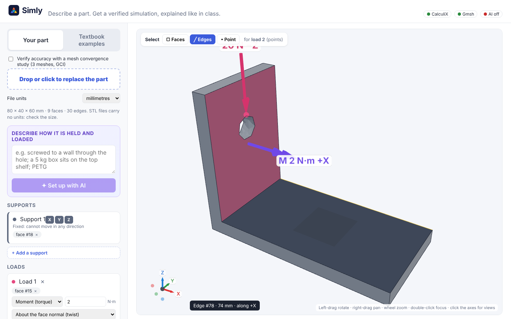
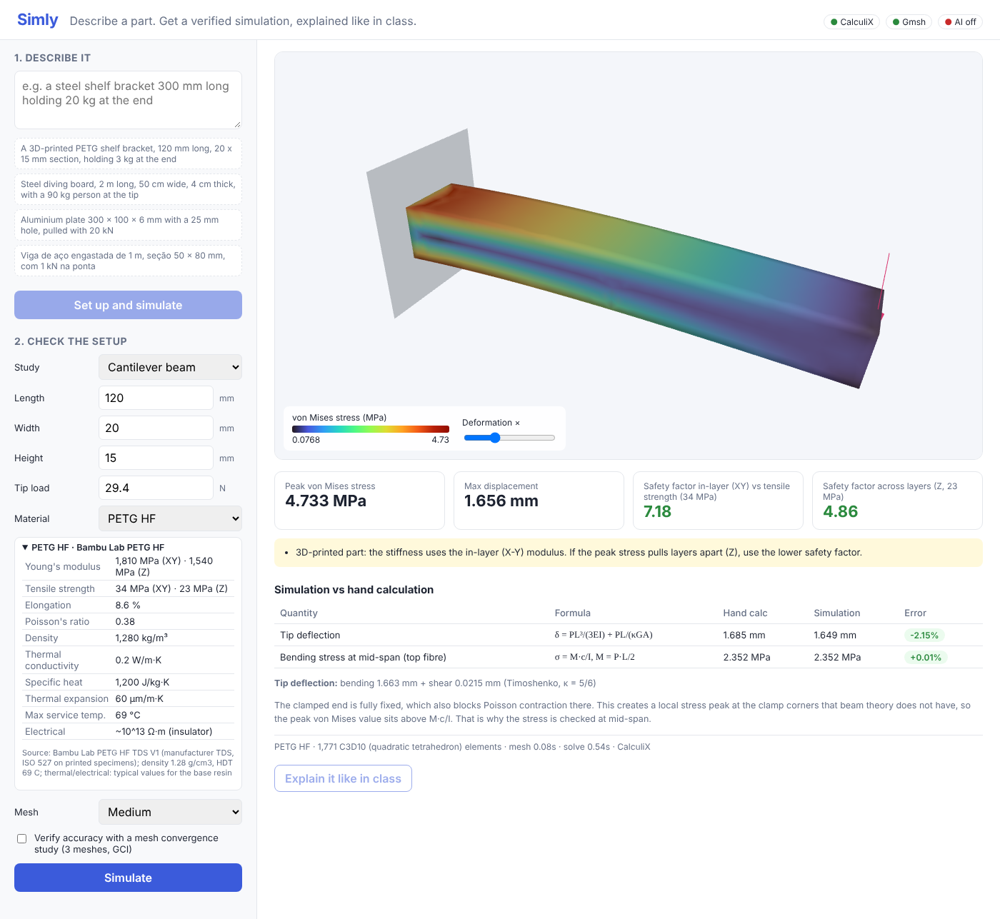
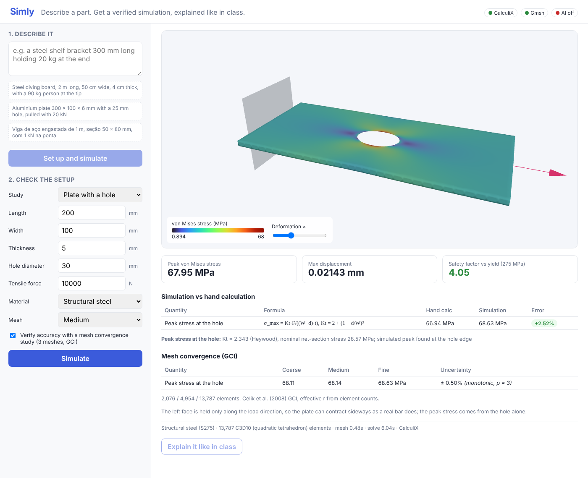

# Simly

[](https://github.com/enzozanatta-eng/simly/actions/workflows/ci.yml)

**Describe a part. Get a verified simulation, explained like in class.**

*"Will my 3D-printed bracket hold 3 kg?"* Most people who design parts
(makers, 3D-printing hobbyists, small workshops, students) never learn finite
element analysis, so they guess, print and hope. Simly answers in seconds:
describe the part in plain language, and it sets up the study, runs a real
solver, and tells you whether it holds, how sure it is, and why.

<p align="center"></p>

## Your own part

Drop an **STL or STEP** file and set the study up in one of two ways:

* **Describe it**: "screwed to the wall through the hole, a 5 kg box sits on
  the top shelf, PETG". The AI reads the part's faces and edges (ids, sizes,
  positions, outward normals) and proposes supports, loads and material, with a
  short rationale. The proposal is validated like a hand-made one and shown on
  the part for you to check and edit.
* **Pick it**: a selection filter switches between **faces, edges and points**
  (points snap to the part's corners). Navigation works like CAD: free
  rotation, pan, zoom towards the cursor, double-click to focus, and an NX-style
  triad in the corner whose axes you click to look along them.

| Supports | Loads |
|---|---|
| fixed, or held in any of X / Y / Z only (rollers, sliding contact) | **force** (N), or the **weight** of a mass (kg) |
| on faces, edges or points | **pressure** (MPa), normal to the surface everywhere, curved faces included |
| | **moment** (N·m, right-hand rule) on a face or an edge |
| | on faces, edges or points, along an axis, the face normal or any vector |

Under the hood every load becomes *consistent* nodal forces for quadratic
elements (mid-side nodes of a 6-node triangle take A/3; a 3-node edge splits
L/6, 4L/6, L/6). A moment is applied as the force distribution of a rigid
twist about the selection's centroid, solved so that the resultant moment is
exactly the one requested and the resultant force exactly zero.

The STL triangles carry no face information, so Simly recovers the faces a
person would click on by splitting the surface at sharp edges (dihedral angle
above 40°) and orients each face outwards with a winding-number test.

An arbitrary shape has no textbook formula, so two checks replace it:

* **Force balance**: the support reactions computed by CalculiX must cancel
  the applied loads (typically to better than 0.001%).
* **Mesh convergence (GCI)** on the peak displacement and stress. When the
  peak stress keeps climbing with every refinement, Simly reports a **stress
  singularity** (a sharp inside corner or the edge of a support) instead of a
  number that is not real, as in the L-bracket above.

## What makes the numbers trustworthy

The interface is for beginners; the engine is not.

| | |
|---|---|
| **Solver** | [CalculiX](http://www.calculix.de), quadratic tetrahedra (C3D10), consistent nodal loads |
| **Independent check** | every result is shown next to the textbook formula for the same case, with the error in % |
| **Discretisation error** | optional 3-mesh study with the Grid Convergence Index (Celik et al., 2008): the answer comes as *value ± uncertainty* |
| **Materials** | every property cites its source; 3D-printed polymers carry in-layer (XY) and across-layer (Z) values from manufacturer data sheets |
| **Validity flags** | warns when stress passes the material strength, when strains leave the linear range, and when printed layers are the weak direction |
| **AI with guard rails** | the language model only *sets up* the study and *explains* results; every number comes from the solver, and every AI-proposed setup passes the same validation as a hand-made one |

### Verification results

Run on the default examples (medium mesh unless noted):

| Case | Quantity | Hand calculation | Simly | Error |
|---|---|---|---|---|
| Steel cantilever, 1000 × 50 × 80 mm, 1 kN | tip deflection (Euler-Bernoulli + shear) | 0.7478 mm | 0.7443 mm | −0.46% |
| | bending stress at mid-span, M·c/I | 9.375 MPa | 9.375 MPa | 0.00% |
| Steel plate 200 × 100 × 5 mm, Ø30 hole, 10 kN | peak stress, Kt (Heywood) · σ_nom | 66.94 MPa | 68.14 MPa | +1.8% |
| | same, mesh study (GCI) | | 68.63 MPa ± 0.50% | |
| Same steel beam uploaded as STEP, faces picked | tip deflection | 0.7478 mm | 0.7445 mm | −0.44% |
| Same beam uploaded as STL | tip deflection | 0.7478 mm | 0.7445 mm | −0.44% |
| Steel shaft Ø20 × 200 mm (STEP), 50 N·m torque on the end face | twist angle, T·L/(G·J) | 7.882 mrad | 8.099 mrad | +2.7% |
| | shear stress, 16T/(πd³), as von Mises √3·τ | 55.13 MPa | 56.66 MPa | +2.8% |

The plate's residual difference is expected: Heywood's Kt is itself an
empirical fit, accurate to a few percent. The shaft's comes from meshing a
circle with straight-sided triangles at the default size; the fine mesh and the
GCI study show it shrinking. Line loads, point loads and pressure are checked
against the same beam theory and against their resultants in the test suite.

## The materials library

30 materials in three groups:

* **3D printing filaments**: PLA, PLA Tough, PETG, PETG HF, ABS, ASA, PC,
  TPU 95A, PLA-CF, PETG-CF, PET-CF, ABS-GF, PAHT-CF. Mechanical values come
  from the manufacturers' technical data sheets, measured on printed specimens
  (ISO 527), in both print directions. Across layers a part can be 10 to 50%
  weaker, so Simly reports two safety factors for printed parts.
* **Metals**: structural steels (S235, S275, S355 per EN 10025), AISI 1045 and
  4140, stainless 304 and 316, aluminium 6061-T6, 6063-T5, 7075-T6, 5052-H32,
  Ti-6Al-4V, copper, brass.
* **Engineering plastics**: POM, PMMA, HDPE.

Each entry has mechanical (E, ν, yield, tensile, elongation), thermal
(conductivity, specific heat, expansion, max service temperature) and
electrical properties. Thermal and electrical data for polymers are typical
values for the base resin, and polymer resistivity is an order of magnitude
only (it varies with humidity and grade). Material data sheets are for
comparison: for a safety-critical part, use your supplier's certified values.

## Textbook examples

<p align="center"></p>

The AI can set these up from a sentence ("a 3D-printed PETG shelf bracket,
120 mm long, holding 3 kg at the end"):

| Template | Teaches | Check against |
|---|---|---|
| `cantilever_beam` | bending, deflection | δ = PL³/3EI + PL/κGA, σ = Mc/I |
| `plate_with_hole` | stress concentration | Kt = 2 + (1 − d/W)³ (Heywood) |

<p align="center"></p>

## Quick start (Ubuntu / WSL)

```bash
sudo apt install calculix-ccx
git clone https://github.com/enzozanatta-eng/simly && cd simly

python3 -m venv .venv && source .venv/bin/activate
pip install -e "backend[ai,dev]"

cd frontend && npm install && npm run build && cd ..   # Node 18+

export OPENAI_API_KEY=...        # or ANTHROPIC_API_KEY; optional, enables the AI features
simly serve                      # open http://127.0.0.1:8000
```

For frontend development, run `simly serve` and `npm run dev` in `frontend/`
(Vite proxies `/api` to the backend).

Without a browser: `simly run spec.json [--convergence]` prints the results as JSON.

## Deploying

The `Dockerfile` builds one container with CalculiX, the API and the web app;
it listens on `$PORT` (default 7860), so it runs on any container host
(Google Cloud Run, Fly.io, Render, a VPS):

```bash
docker build -t simly .
docker run -p 7860:7860 -e OPENAI_API_KEY=... simly
```

Guard rails for a public deployment: at most `SIMLY_MAX_JOBS` simulations at a
time (default 2), `SIMLY_AI_PER_HOUR` AI calls per visitor IP (default 30),
size limits in the study specs so no request can ask for a huge mesh, and run
folders deleted after each study.

## How it works

```
plain-language request
   │  AI (tool use): one tool per template; proposals are validated, and
   │  rejections are sent back with the reason so the model corrects itself
   ▼
study spec (pydantic)  ── physics rules: "a 100 mm block is not a beam",
   │                        "hole/width outside the Kt formula's range", ...
   ▼
Gmsh (OpenCASCADE)  → quadratic tet mesh, faces named per template
   ▼
CalculiX            → displacements, stresses
   ▼
checks: hand calculation, GCI, strength (XY/Z), strain validity
   ▼
web app: 3D view (three.js) + results + "explain it like in class" (AI, numbers given)
```

```
backend/src/simly/
  spec.py         study specs and their validation rules
  materials.py    material library with sources
  geometry.py     template geometry + Gmsh meshing (thread-safe)
  parts.py        uploaded STL/STEP: storage, face/edge detection, outward normals
  loads.py        consistent nodal loads: force, pressure, moment on faces/edges/points
  solver.py       CalculiX deck, consistent traction loads, .frd reader
  templates.py    boundary conditions and hand calculations per template
  study.py        spec -> mesh -> solve -> results, strength checks
  convergence.py  3-mesh GCI study (Celik et al., 2008)
  llm.py          provider-neutral LLM client (OpenAI or Anthropic)
  ai.py           request -> spec, results -> explanation
  api.py          FastAPI endpoints
frontend/src/     React + TypeScript + three.js
```

The whole pipeline is tested in CI against the hand calculations; the AI
layer is tested with a scripted model, so CI needs no API key.

## Roadmap

- [x] Upload your own part (STL/STEP) and click the faces that are fixed and loaded
- [ ] AI-generated geometry from a description (parametric CadQuery)
- [ ] Self-weight and pressure loads; more templates (shafts, plates, brackets)
- [ ] Thermal studies (conduction, heat sinks) using the thermal properties already in the library
- [ ] Simple aerodynamics (2D drag) with OpenFOAM

## License

MIT
